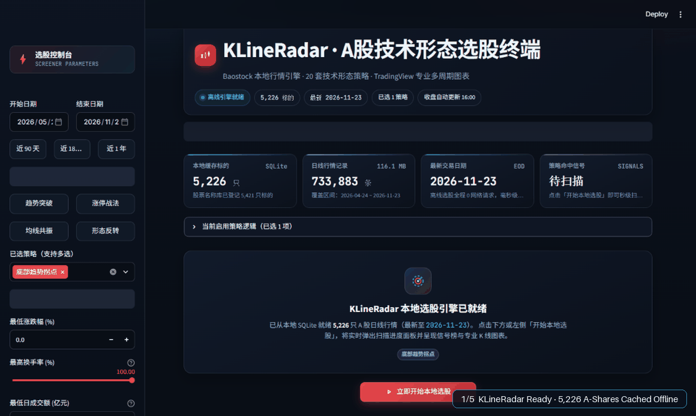

# KLineRadar · A股技术形态选股终端

<p align="center">
  <a href="https://github.com/henryorpeter/baostock-visual-screener/stargazers">
    
  </a>
  <a href="https://github.com/henryorpeter/baostock-visual-screener/network/members">
    
  </a>
  <a href="https://www.python.org/">
    
  </a>
  <a href="https://streamlit.io/">
    
  </a>
  <a href="https://opensource.org/licenses/MIT">
    
  </a>
</p>

> 🌟 **如果这个项目对你的日常复盘、技术形态选股或 Python 可视化有所启发，请动动手指在右上角点一个 Star ⭐️ 吧！**  
> 你的每一个 Star 都是作者持续优化代码、新增经典战法与维护数据接口的最大动力！欢迎点击上方按钮或仓库右上角加星关注更新 ↗️

---

基于 **Python+baostock** 构建的 A 股市场的量化选股系统终端。支持全市场历史日线本地 SQLite 缓存、20 套经典技术形态策略实时扫描、交互式信号榜与专业多周期 K 线看盘。

> **免责声明**：本工具仅供技术形态研究与复盘学习参考，所有筛选信号与历史胜率统计均不构成任何投资建议。

<p align="center">
  <br />
  <sub><b>演示：0.4 秒全市场扫描 → 信号榜 / 多策略共振聚合 → 点击联动 TradingView 日线 / 周线 + MACD 副图</b></sub>
</p>

---

## 核心特性

- **专业暗黑金融终端 UI（支持平板与手机）**：内置 `.streamlit/config.toml` 深色主题与自定义终端风格样式，集成 Ant Design 导航栏、分段控制器与标签筛选；支持平板/手机自适应排版，并在侧边栏提供 **「手机紧凑视图」** 一键开关（精简核心列免横滑 + 调低 K 线图高度）。
- **纯 NumPy 极速离线选股引擎**：全市场行情落盘至本地 `stock_cache.sqlite3` 并内置版本感知内存数组缓存，**5,000+ 只 A 股全市场扫描冷启动约 2.7 秒、热缓存仅约 0.4 秒**，日常复盘完全离线运行。
- **收盘后自动增量更新**：内置后台守护调度器，每个交易日（周一至周五）收盘后（默认 `15:35`，可在「数据源与缓存中心」自定义时间与开关）自动在后台增量补齐当日行情一次，不阻塞前端选股看盘，周末休市与当日已更新状态自动跳过。
- **极速增量日更与三级容灾**（首次全量同步约 5~10 分钟，之后每日收盘秒级更新）：
  1. **日常收盘极速日更**：更新前先预检最近已收盘交易日并复用本地股票池缓存；仅缺最新交易日的标的走 **腾讯批量截面接口**（每次 300 只、8 路并发，18 次请求即可补齐 OHLCV 与换手率），并自动比对昨收价校验除权连续性。
  2. **多日缺口并发回补**：除权股或跨多日缺口通过 **东方财富 / 腾讯财经 10 路 HTTP 连接池** 并发拉取前复权历史日线并批量写入 SQLite。
  3. **Baostock 兜底**：HTTPS 均未命中的残余标的自动回退 Baostock 证券宝补齐。
- **实时悬浮进度反馈**：选股扫描与行情同步均配有居中悬浮实时进度面板，清晰展示当前阶段、百分比、耗时、已扫描数量与实时命中条数。
- **交互式信号榜 + 多策略共振聚合 + 专业图表联动**：
  - 支持 **「按信号展开 / 按股票聚合」** 一键切换，聚合视图按**多策略共振数**降序排列，一眼挑出同时触发多个战法的标的。
  - 信号表内置 **A 股红涨绿跌高亮**、**成交额(亿)**、**换手率进度条**、**近 20 日迷你走势折线图（Sparkline）**，支持排除 ST、排除双创、最低日成交额过滤、策略标签筛选与 UTF-8 CSV 导出。
  - **点击表格任意一行**直接联动下方个股终端，支持「上一只 / 下一只」快速翻阅与一键加入自选。
  - 集成 **TradingView Lightweight Charts v5**，支持日线 / 周线 / 月线切换、MA5/10/20/30 均线、成交量及可开关的 **MACD (12, 26, 9)** 副图。
- **历史胜率速验（回测辅助）**：将左侧「结束日期」调至历史某交易日并重新选股，自动利用本地历史日线统计各策略命中标的随后 **5 日 / 10 日胜率与平均涨幅**（*仅作历史统计研究，不代表未来收益*）。
- **本地自选观察池**：内置 SQLite `watchlist` 持久化存储，个股终端一键 `☆ 加自选 / ★ 已自选`，顶部独立 **「自选观察池」** 标签页集中跟踪与多周期复盘。
- **20 套独立技术策略矩阵**：按「趋势突破 / 涨停战法 / 均线共振 / 形态反转」四大流派归类，涨跌停相关战法按板块自动区分 **主板 10% / 双创 20% / 北交所 30%** 幅度阈值。

---

## 项目目录结构

```text
baostock-visual-screener/
├── .streamlit/
│   └── config.toml          # Streamlit 暗黑金融终端原生主题配置
├── assets/                  # 演示动图与界面预览素材
├── baostock_screener.py     # 主程序（数据抓取、缓存、NumPy 策略引擎与可视化界面）
├── start.bat                # Windows 一键双击启动脚本
├── requirements.txt         # Python 依赖清单
├── LICENSE                  # MIT 开源许可证
├── stock_cache.sqlite3      # 本地行情与自选池缓存库（首次更新后自动生成，已加入 .gitignore）
└── README.md                # 项目说明与手动部署文档
```

---

## 手动部署操作说明

### 环境要求

- **Python**：建议 `3.10` ~ `3.13`
- **网络**：首次拉取行情需可访问 Baostock（`public-api.baostock.com:10030`）或同花顺 / 腾讯财经 HTTPS 域名；缓存建立完成后日常选股可离线使用。

---

### 方式一：Windows 本地手动部署（PowerShell）

1. **克隆项目并进入目录**

   ```powershell
   git clone https://github.com/henryorpeter/baostock-visual-screener.git
   cd baostock-visual-screener
   ```

2. **创建并激活 Python 虚拟环境**

   ```powershell
   py -m venv .venv
   .\.venv\Scripts\Activate.ps1
   ```

   > 若提示 PowerShell 执行策略禁止运行脚本，可先执行一次：
   > ```powershell
   > Set-ExecutionPolicy -ExecutionPolicy RemoteSigned -Scope CurrentUser
   > ```

3. **安装依赖包**

   ```powershell
   python -m pip install --upgrade pip
   python -m pip install -r requirements.txt
   ```

   > 如国内下载较慢，可临时指定清华源：
   > ```powershell
   > python -m pip install -r requirements.txt -i https://pypi.tuna.tsinghua.edu.cn/simple
   > ```

4. **启动应用**

   完成上述依赖安装后，可直接双击根目录的 `start.bat`，或在 PowerShell 中运行：

   ```powershell
   streamlit run baostock_screener.py
   ```

   启动后浏览器将自动打开 `http://localhost:8501`。如需指定端口：

   ```powershell
   streamlit run baostock_screener.py --server.port 8502
   ```

---

### 方式二：macOS / Linux 本地手动部署

1. **克隆代码**

   ```bash
   git clone https://github.com/henryorpeter/baostock-visual-screener.git
   cd baostock-visual-screener
   ```

2. **创建并激活虚拟环境**

   ```bash
   python3 -m venv .venv
   source .venv/bin/activate
   ```

3. **安装依赖并启动**

   ```bash
   pip install --upgrade pip
   pip install -r requirements.txt
   streamlit run baostock_screener.py
   ```

   在浏览器访问 `http://localhost:8501` 即可。

---

### 方式三：Linux 服务器手动后台部署（长期运行 / 局域网访问）

适合部署在云服务器、NAS 或内网 Linux 主机上，通过浏览器远程访问。

1. **准备环境与依赖**

   ```bash
   git clone https://github.com/henryorpeter/baostock-visual-screener.git /opt/baostock-visual-screener
   cd /opt/baostock-visual-screener
   python3 -m venv .venv
   ./.venv/bin/pip install --upgrade pip
   ./.venv/bin/pip install -r requirements.txt
   ```

2. **快速后台启动（`nohup` 方式）**

   ```bash
   nohup ./.venv/bin/streamlit run baostock_screener.py \
     --server.address 0.0.0.0 \
     --server.port 8501 \
     --server.headless true \
     > screener.log 2>&1 &
   ```

   查看日志：

   ```bash
   tail -f screener.log
   ```

3. **生产推荐：`systemd` 守护进程托管（开机自启 + 异常自动拉起）**

   新建服务文件 `/etc/systemd/system/baostock-screener.service`：

   ```ini
   [Unit]
   Description=Baostock Visual Stock Screener
   After=network.target

   [Service]
   Type=simple
   User=root
   WorkingDirectory=/opt/baostock-visual-screener
   ExecStart=/opt/baostock-visual-screener/.venv/bin/streamlit run baostock_screener.py --server.address 0.0.0.0 --server.port 8501 --server.headless true
   Restart=always
   RestartSec=5

   [Install]
   WantedBy=multi-user.target
   ```

   启用并启动服务：

   ```bash
   sudo systemctl daemon-reload
   sudo systemctl enable --now baostock-screener
   sudo systemctl status baostock-screener
   ```

4. **防火墙与反向代理提示**
   - 若直接通过 `http://<服务器IP>:8501` 访问，请在系统防火墙及云厂商安全组放行 `8501/TCP` 端口。
   - 若通过 **Nginx** 反向代理域名访问，务必开启 WebSocket 转发（Streamlit 依赖 `/_stcore/stream` 长连接）：

     ```nginx
     location / {
         proxy_pass http://127.0.0.1:8501;
         proxy_http_version 1.1;
         proxy_set_header Upgrade $http_upgrade;
         proxy_set_header Connection "upgrade";
         proxy_set_header Host $host;
         proxy_read_timeout 86400;
     }
     ```

---

### 离线行情缓存跨机迁移

本地行情完整存储在项目根目录的 `stock_cache.sqlite3` 单文件中。如果你已在某台电脑完成全市场同步，只需直接将该文件复制到另一台机器的同级目录，重启应用即可免等待直接使用。

---

## 日常使用指南

1. **首次同步行情缓存**
   - 在左侧「选股控制台」选定日期区间（默认近 180 天，可一键切换近 90 天 / 180 天 / 1 年）。
   - 点击 **「更新全市场行情缓存」**，等待悬浮进度面板同步完成（首次全量拉取约需数分钟；之后每次仅增量补齐最新交易日）。
2. **配置策略与过滤条件**
   - 在侧边栏一键套用流派预设（趋势突破 / 涨停战法 / 均线共振 / 形态反转），或在下拉框中自由多选策略，也可进入 **「策略百科矩阵」** 浏览全部 20 套策略逻辑。
   - 按需设置最低涨跌幅、换手率区间滑块与扫描股票上限（默认 6,000 只）。
3. **执行本地选股与看盘分析**
   - 点击 **「开始本地选股」**（或主界面的 **「立即开始本地选股」**），界面居中弹出实时进度面板。
   - 扫描完成后可在 **「策略信号榜」** 中按策略标签或关键字筛选、导出 CSV；点击表格中任意一行即可在下方 **「个股深度行情终端」** 查看多周期 K 线、MA 均线、成交量及 MACD 副图。

---

## 内置 20 套选股策略一览

| 策略流派 | 包含策略 | 核心思路 |
| :--- | :--- | :--- |
| **趋势突破** | 海龟突破策略、阻力位突破策略、高旗形整理策略、趋势加速拐点、趋势起点策略、RPS强势突破 | 捕捉前高放量突破、高位收敛缩量蓄势、均线加速及 120 日相对强度前 10% 领涨股 |
| **涨停战法** | 涨停回马枪策略、涨停横盘策略、涨停洗盘策略、强势洗盘弱转强、上升趋势跌停反包 | 围绕近期涨停基因、缩量回踩支撑、窄幅横盘突破及强势洗盘反包机会 |
| **均线共振** | 多金叉共振、2560战法、金三角策略、金叉不绿策略 | MA / 均量 / MACD / KDJ 多维度金叉共振与阳线确认 |
| **形态反转** | 底部趋势拐点、启明星策略、多方炮策略、仙人指路策略、W底策略 | 识别深跌超卖拐点、启明星、两阳夹一阴、长上影试盘与双底颈线突破 |

---

## 常见问题（FAQ）

- **Q：提示 Baostock 连接失败怎么办？**  
  A：若当前网络无法直连 `public-api.baostock.com:10030`，程序会自动切换至同花顺 / 腾讯财经 HTTPS 备用源补齐行情。需注意腾讯备用源日线不包含换手率字段，对应股票的换手率将留空并在选股时自动跳过换手率条件。
- **Q：为什么缓存更新完成后仍有少量失败项？**  
  A：部分刚停牌、退市整理期或接口瞬时限流的标的可能单次拉取失败，可在「数据源与缓存中心」查看失败明细，再次点击「更新全市场行情缓存」会自动跳过已完成项、仅重试缺失标的。
- **Q：页面显示不是暗黑主题怎么办？**  
  A：请确认项目根目录下存在 `.streamlit/config.toml` 文件，并且是在项目根目录执行 `streamlit run baostock_screener.py` 启动。

---

## ⭐️ 欢迎 Star 与交流共建

开源不易，如果这个小工具对您有所帮助或带来了启发：
- 请在右上角点击一下 **Star ⭐️** 支持我们，让更多技术分析与复盘爱好者看到这个项目！
- 如果您有新的技术战法、指标思路、改进建议或交流合作，非常欢迎发送邮件至 **[1561784670@qq.com](mailto:1561784670@qq.com)**，或在 GitHub 提交 [Issues](https://github.com/henryorpeter/baostock-visual-screener/issues) 共同交流共建！

---

## 打赏支持

如果这个项目帮到了你，可以请作者喝杯咖啡 ☕

<table>
  <tr>
    <td align="center">
      <br />
      <sub><b>微信赞赏</b></sub>
    </td>
    <td align="center">
      <br />
      <sub><b>支付宝打赏</b></sub>
    </td>
  </tr>
</table>

---

## 免责声明

1. **非投资建议**：本项目及内置的所有选股策略、技术指标与可视化图表仅用于编程学习、行情数据分析与技术形态研究，**不构成任何证券买卖建议、投资指导或收益承诺**。
2. **历史与信号局限性**：所有筛选信号均基于历史日线 OHLCV 数据的规则化计算，历史形态与回测表现不代表未来走势；市场存在突发风险、流动性风险及跳空缺口等不可控因素。
3. **第三方数据源说明**：行情数据来源于 Baostock、同花顺、腾讯财经等公开第三方接口，作者不对数据的实时性、完整性、准确性或接口长期可用性作任何担保。
4. **风险自担**：股市有风险，投资需谨慎。使用本工具所做出的一切分析判断与交易决策均由使用者自行负责，项目作者不承担因使用或无法使用本工具所导致的任何直接或间接经济损失。

---

## 📄 开源协议

本项目采用 [MIT License](./LICENSE) 开源协议。

